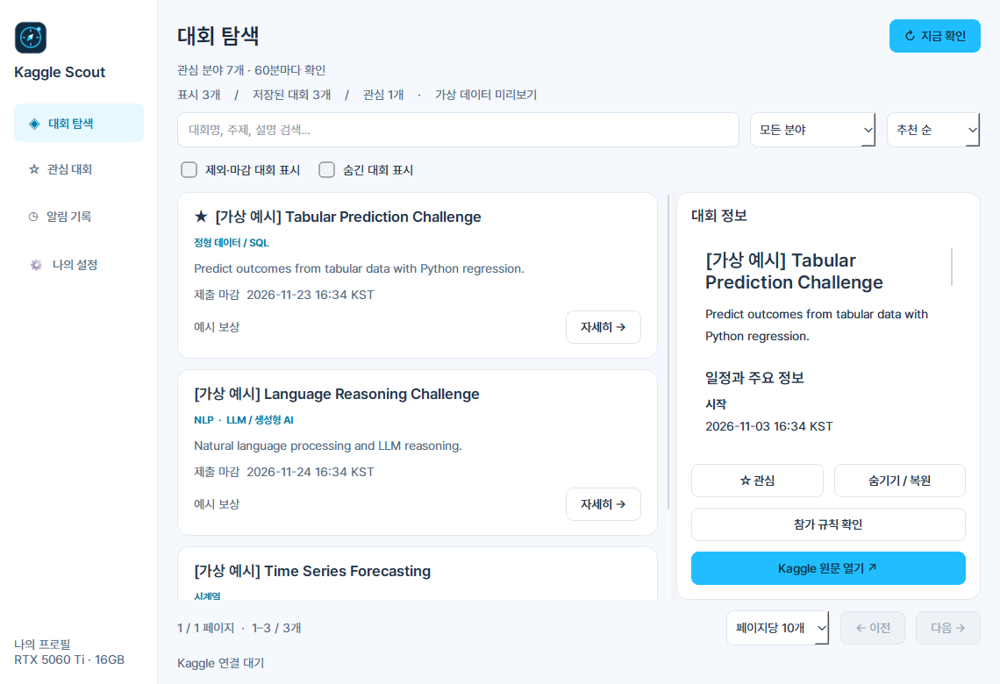

# Kaggle Scout

현재 버전: **0.2.0** · Windows 데스크톱

Kaggle 대회를 모아 개인의 관심 분야와 환경에 따라 정렬하고 새 대회·관심 대회 변경·마감 일정을 알려주는 Windows 데스크톱 앱입니다. 생성형 AI, LLM API, 유료 AI API를 호출하지 않습니다. Kaggle과는 독립적인 비공식 개인 프로젝트입니다.



## 시작하기

1. 바탕화면의 **Kaggle Scout** 바로가기를 실행하거나 `dist/KaggleScout/KaggleScout.exe`를 실행합니다. 배포본은 `KaggleScout` 폴더 전체를 함께 유지하세요.
2. 최초 실행에서 [Kaggle API 설정](https://www.kaggle.com/settings/api)을 열고 개인 API 토큰을 생성하여 앱에 입력합니다. 기존 `kaggle.json`의 username/key 인증도 지원합니다. 이 인증은 유료 AI API와 별개입니다.
3. 앱이 Kaggle 대회 조회로 연결을 검증한 뒤 Windows 현재 사용자 계정으로 인증 정보를 암호화하여 저장합니다. 토큰을 GitHub나 채팅에 올리지 마세요.
4. 나의 설정에서 기본 프로필을 확인하고 **설정 저장하고 대회 확인**을 누릅니다.
5. 관심 대회를 등록하면 해당 대회의 정보 변경과 마감 임박 알림을 받습니다.

창의 X를 누르면 시스템 트레이에서 계속 실행됩니다. 트레이 메뉴의 **완전히 종료**로 종료합니다. Windows 알림 설정이나 방해 금지 모드에 따라 알림 표시가 제한될 수 있으며, 앱의 알림 기록에서도 확인할 수 있습니다.

## 기본 프로필

- 관심: 정형 데이터/SQL, 시계열, NLP, LLM/생성형 AI, 이미지/영상, 음성, AI 서비스/웹 개발
- 보유 기술: Python, SQL
- GPU: RTX 5060 Ti, VRAM 16GB
- 유료 API: 사용하지 않음
- 목적: 학습, 포트폴리오, 취업, 수상 모두
- 개인/팀 모두 포함, 준비 기간 최소 조건 없음
- 학생 전용·오프라인 필수 문구가 감지되면 제외
- 기본 확인 주기 60분, 설정 가능 범위 15~1440분

관심 분야, GPU/VRAM, API 허용 여부, 제외 키워드, 알림, 탐색 점수 하한은 앱에서 수정할 수 있습니다. 프로필 JSON 내보내기/가져오기는 인증 정보와 수집 기록을 포함하지 않습니다. 활성 프로필은 앱 인스턴스당 하나입니다. 여러 PC에서는 각각 연결하고 프로필을 가져올 수 있습니다. 동시 다중 계정 관리나 자동 클라우드 동기화는 지원하지 않습니다.

## 수집과 추천의 범위

공식 Kaggle Public API의 `ListCompetitions`를 사용합니다. 앱은 참가 신청, 데이터 다운로드, 제출, 약관 동의를 자동 수행하지 않습니다. 전체 목록을 페이지별로 조회하고 로컬에서 관심 분야·제외 조건에 따라 추천 순서와 알림 대상을 정합니다. 설정마다 별도 사이트를 크롤링하는 방식은 아닙니다.

- 제목·설명·태그에서 관심 분야 키워드를 찾고, 입문/연습 카테고리에 가산점을 주는 결정적 규칙 기반 추천입니다. 점수는 수상 가능성이나 객관적인 실력 적합도 확률이 아닙니다.
- 보유 기술 입력은 현재 프로필 메모입니다. 기술 수준이나 예상 소요 시간을 추론하지 않습니다.
- 공개 설명에서 명시적인 최소 VRAM 요구 문구가 감지되면 프로필의 VRAM과 비교합니다. 정보가 없으면 **확인 필요**로 표시합니다. CUDA 지원, 학습 시간, CPU/RAM/저장공간과 실제 실행 가능성은 검증하지 않습니다.
- 학생 전용/오프라인 필수/유료 API 필수 감지는 제한된 영어·한국어 문구 기반입니다. 부정문·인용문 등에서 오탐이 있을 수 있습니다. 감지 결과는 원문 검토 대상으로 표시하며, 제외 대회 표시 옵션으로 확인하고 설정을 바꿀 수 있습니다.
- 참가 자격이 불명확한 대회는 일반인 참가 가능으로 단정하지 않고 **확인 필요** 후보로 보여줍니다. 국가·연령·상금 수령 자격 등도 원문에서 확인하세요.
- 목록 API가 제공한 시작일·신규 참가 마감·팀 구성 마감·최종 제출 마감을 구분하여 KST로 표시합니다. 누락된 일정은 생성하지 않습니다.
- **규칙·설명 추가 조회**는 선택한 대회에 공식 `ListCompetitionPages` 조회를 시도합니다. 권한에 따라 제공되지 않을 수 있으며, 이 경우 원문 링크를 사용합니다. 추가 페이지의 자동 주기 재조회는 현재 지원하지 않습니다. 자동 변경 감지는 목록 API가 제공하는 필드에 적용됩니다.
- 최초 수집은 기존 대회를 개별 신규 알림으로 보내지 않습니다. 이후 새 추천, 관심 대회의 주요 정보 변경, 관심 대회의 참가/팀/제출 마감 7·3·1일 이내 진입을 기록합니다. 팀 수나 순위 변화는 변경 알림을 발생시키지 않습니다.
- 수집 실패 시 기존 기록을 유지하고 마지막 성공 시각과 오류를 표시합니다. 완전한 페이지 수집이 끝나기 전에는 부분 결과를 저장하지 않습니다. 목록에서 사라진 대회를 자동 삭제하지 않습니다.
- PC가 켜져 있고 앱이 실행 중일 때만 수집합니다. 실행 직후와 절전 복귀 후 지난 주기를 확인합니다. 전원이 꺼진 동안의 즉시 알림이나 완전한 과거 변경 이력 복원은 불가능합니다.

## 데이터와 인증 저장

실행 위치 옆 `data/scout.sqlite3`에 프로필, 수집 기록, 관심/숨김, 알림 이력과 **Windows DPAPI 암호문** 형태의 인증 정보가 저장됩니다. 다른 Windows 계정이나 PC에서는 다시 연결합니다. data 폴더는 Git에서 제외합니다. 앱은 홈 디렉터리에 인증 파일을 작성하지 않습니다.

기존 JSON 파일로 연결할 때 원본 파일은 이동하거나 삭제하지 않습니다. 최초 연결에서 검증에 성공한 인증 정보만 저장합니다. 새 토큰 연결은 검증 성공 후 기존 연결을 대체합니다.

로그인 자동 시작은 설정에서 선택할 때만 현재 사용자의 Windows Run 레지스트리에 등록합니다. 폴더를 옮기면 새 위치에서 자동 시작 설정을 다시 저장하세요. 앱을 삭제하기 전 자동 시작을 꺼주세요.

## 개발 / 빌드

Python 3.12, Windows에서 개발했습니다.

```powershell
python -m venv .venv
.\.venv\Scripts\Activate.ps1
python -m pip install -r requirements.txt
python app.py
python -m unittest -v
.\build.ps1
.\verify-build.ps1
.\package.ps1
```

`python app.py --preview`는 별도 `preview-data` 폴더에서 네트워크 없이 UI를 확인합니다. 기본적으로 가짜 대회를 넣지 않습니다. `SCOUT_DATA_DIR` 환경변수로 별도 데이터 폴더를 지정할 수 있습니다.

`package.ps1`은 실행 파일과 `_internal` 런타임만 명시적으로 복사하여 `releases/KaggleScout-v0.1.1-windows-x64.zip`을 만듭니다. 개인 데이터·인증·테스트 저장소는 배포 ZIP에 포함하지 않습니다. ZIP을 푼 뒤 안쪽 `KaggleScout.exe`를 실행합니다. Python을 별도로 설치할 필요가 없습니다.

구조: `core.py` 수집·추천·SQLite·DPAPI / `app.py` Qt UI·첫 연결·주기 관리·트레이 / `assets/` 아이콘·폰트 / `test_core.py` 핵심 로직 테스트.

## 디자인과 참고

- [Figma 디자인: 대시보드 · 최초 연결 · 프로필 설정](https://www.figma.com/design/JVhaimvEcSmeM8yHuj5mpo)
- Kaggle 하늘색 `#20BEFF`, 네이비 `#102C43`, 밝은 배경과 카드 기반 목록/상세 화면
- 직접 제작한 나침반 아이콘: `assets/scout.svg`, PNG, Windows ICO
- Pretendard 1.3.9 정적 폰트 (Regular / Medium / SemiBold / Bold): SIL Open Font License, `assets/Pretendard-LICENSE.txt`. [공식 배포](https://github.com/orioncactus/pretendard/releases/tag/v1.3.9)
- [Kaggle API 문서](https://www.kaggle.com/docs/api), [공식 CLI 대회 문서](https://github.com/Kaggle/kaggle-cli/blob/main/docs/competitions.md)

## 현재 검증 상태

규칙 기반 추천, 페이지 처리, 실패 시 데이터 보존, 중복 알림 방지, 마감 알림, Windows 암호화 왕복, UI 구동과 Windows 빌드를 로컬에서 검증합니다. 실제 개인 계정 토큰은 개발 과정에서 제공받지 않았으므로 **인증 성공 후 실계정 수집은 사용자의 최초 연결에서 최종 확인해야 합니다.**

## 버전 및 작업 로그

작업 단위마다 소스 변경과 해당 README 로그를 함께 커밋합니다. 기능 추가는 `feat`, 오류 수정은 `fix`, 문서는 `docs`, 빌드·배포는 `build` 접두사를 사용합니다. 기능 동작이나 배포물이 바뀔 때 버전을 올리고, 문서만 바뀌면 현재 버전 아래에 기록합니다. 실제 배포 버전에는 Git 태그를 붙입니다.

| 날짜 (KST) | 버전 / 작업 단위 | 변경 내용 | 검증 |
|---|---|---|---|
| 2026-11-05 | 0.1.0 · 최초 구현 (`396e175`) | Kaggle 첫 연결, DPAPI 인증 저장, 주기 수집, 개인 프로필, 관심·숨김, 변경·마감 알림, 검색·필터, Qt UI, 아이콘, Figma 디자인 | 핵심·UI 테스트 15개 통과. 소스 UI와 창 크기별 화면 점검. Windows 빌드 성공. 실계정 인증은 최초 실행에서 확인 필요 |
| 2026-11-05 | 0.1.0 · 관리 문서 정리 | 작업 단위별 커밋 규칙, 버전·변경·검증 로그 도입. 최초 구현 이력 유지 | GitHub 비공개 저장소와 소스 파일 목록 확인. 인증·개인 기록 제외 규칙 적용 |
| 2026-11-05 | 0.1.1 · 실행 파일 DLL 충돌 수정 | 최초 배포 검증에서 QtCore 로드 실패 확인. PATH의 외부 Poppler ICU DLL이 섞인 것이 원인. Python·Windows 경로로 한정한 클린 빌드로 변경. 실행 파일 전용 검증 스크립트 추가 | `verify-build.ps1` 통과: 새 실행 파일이 실제 GUI를 렌더링하고 종료 코드 0으로 종료. 충돌 ICU DLL 미포함 확인. 실계정 인증은 최초 연결에서 확인 필요 |
| 2026-11-05 | 0.1.1 · Windows 배포 패키지 | 개인 데이터가 포함되지 않는 ZIP 생성 스크립트와 배포용 시작 안내 추가. 바탕화면 바로가기 제공. GitHub 비공개 배포 버전 관리 | 배포 ZIP 파일 목록·SHA256 확인. 실행 파일 직접 구동 검증 통과. 인증·수집 DB는 배포 대상에서 제외 |
| 2026-11-05 | 0.2.0 · 폰트·화면·페이지 개선 | Pretendard 정적 굵기 4종, 기본 창 1140×780 / 최소 960×680, 큰 상단 안내·반복 문구 축소. 페이지당 5·10·20·50개 및 이전/다음 이동 추가 | 테스트 17개 통과. 23개 목록의 페이지 누락·중복 방지, 검색 시 페이지 초기화, 표시 개수 저장 확인. 가상 데이터로 화면 점검 |

### 0.2.0 화면 설정

목록 하단 또는 나의 설정에서 **페이지당 표시 개수**를 바꿀 수 있습니다. 이 값은 화면에 보이는 대회 개수이며, Kaggle API에서 수집하는 전체 페이지 수를 제한하지 않습니다. 검색·정렬·분야 필터는 전체 수집 목록에 적용한 뒤 페이지를 나눕니다.
