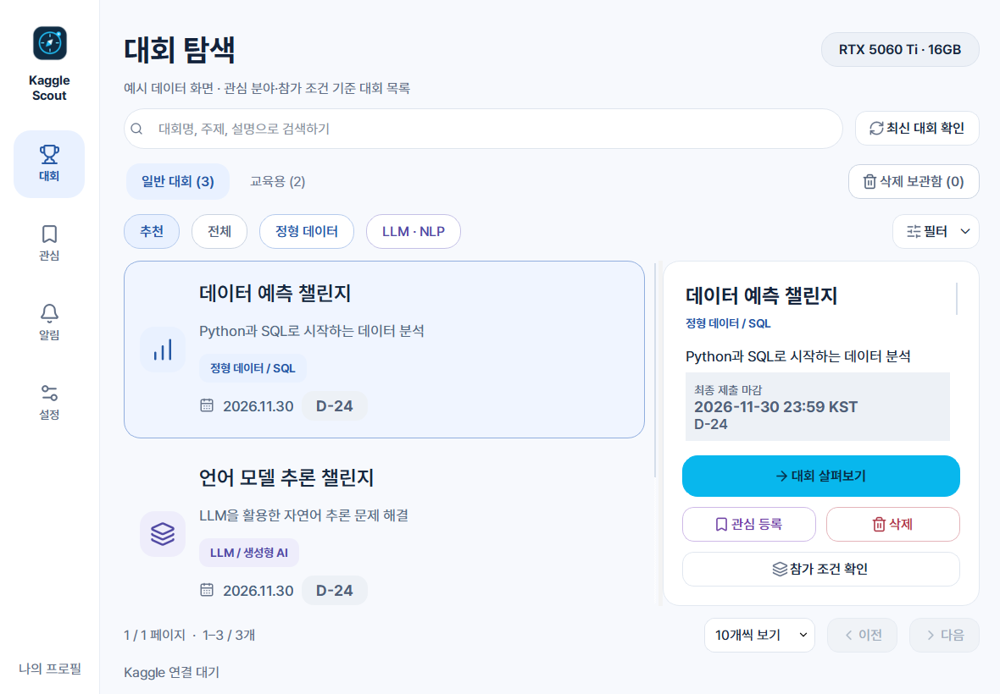
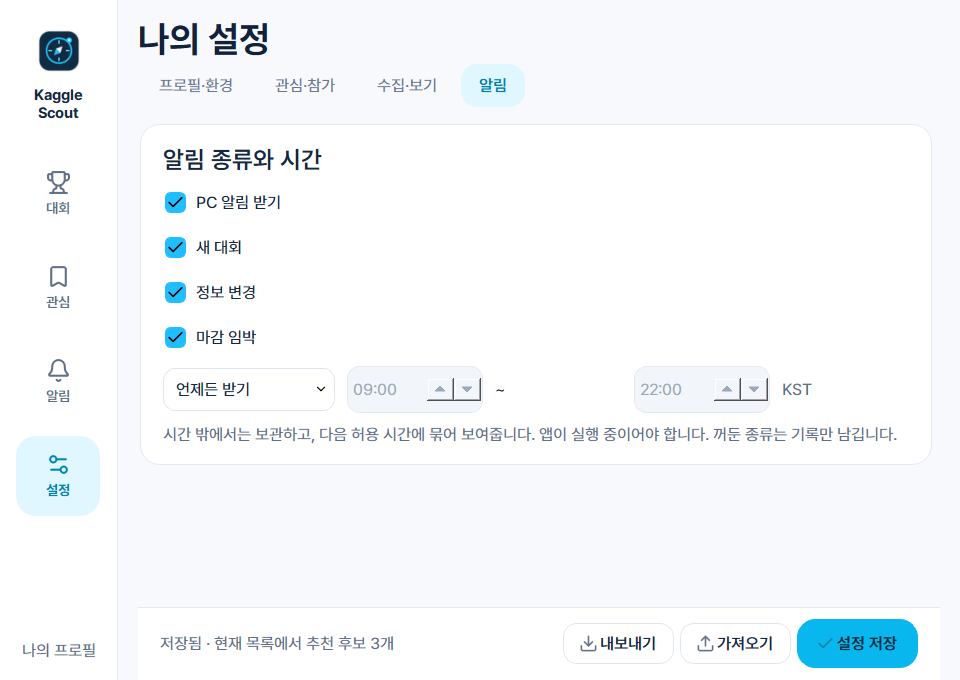

# Kaggle Scout

현재 버전: **0.9.0** · Windows 10/11 개인용 Kaggle 대회 알림 앱. 생성형 AI API를 사용하지 않습니다. Kaggle과 독립적인 비공식 프로젝트입니다.

0.9.0은 오른쪽을 전체 정보 하나로 통합하고 항목 구분·표 정렬·마감 강조로 읽기 쉽게 정리합니다. 향후 개선 우선순위는 [ROADMAP.md](ROADMAP.md)에 정리했습니다.



## 실행과 계정 연결

바탕화면 **Kaggle Scout** 바로가기를 실행하세요. 첫 화면에서 [Kaggle API 설정](https://www.kaggle.com/settings/api)의 개인 API 토큰을 입력하거나 기존 `kaggle.json`을 선택합니다. 연결 검증 후 프로필을 확인하고 **설정 저장하고 대회 확인**을 누릅니다. 토큰은 채팅이나 GitHub에 올리지 마세요.

창을 닫으면 트레이에서 계속 실행됩니다. 트레이 메뉴의 **종료**로 종료합니다. PC와 앱이 실행 중일 때만 확인하며, Windows 방해 금지 설정에 따라 알림 표시가 제한될 수 있습니다. 알림 기록은 앱에서도 볼 수 있습니다.

## 설치 위치

- 프로그램: `%LOCALAPPDATA%\Programs\KaggleScout\versions\0.9.0\KaggleScout.exe`
- 설정·인증·대회·알림 기록: `%LOCALAPPDATA%\KaggleScout\scout.sqlite3`
- 바탕화면과 시작 메뉴: 실행 바로가기
- 개발 소스: 설치 폴더와 별도로 관리하는 Git 저장소

`install.ps1`은 관리자 권한 없이 현재 Windows 사용자에게 설치합니다. ZIP 전체를 푼 뒤 `install.ps1`을 실행하거나, ZIP 안의 `KaggleScout.exe`를 직접 실행할 수 있습니다. 직접 실행해도 기본 데이터 위치는 LocalAppData입니다. 실행 파일과 `_internal` 폴더를 함께 유지하세요. 폴더 옆에 데이터를 저장하려면 `KaggleScout.exe --portable`을 사용합니다. `SCOUT_DATA_DIR` 환경변수는 테스트·사용자 지정 데이터 경로용입니다.

설치와 업데이트는 기존 사용자 DB를 덮어쓰지 않습니다. 구버전 `dist/KaggleScout/data` DB가 남아 있으면 SQLite 백업으로 이전하고, 빌드 전에 `work/private-data-backups`에도 백업합니다. 초기 0.2.0 전환 시에는 구버전 원본 DB가 없어 인증·기록을 복구하지 못했습니다. 이후 업데이트는 별도 사용자 DB를 유지합니다. Windows 계정이나 PC가 달라지면 DPAPI 인증도 다시 연결해야 합니다.

자동 시작은 설정에서 선택한 경우에만 등록합니다. 설치 프로그램은 기존 자동 시작 선택을 유지하면서 실행 경로를 갱신합니다.

## 개인 설정

### 0.5.0 디자인 개편

선택한 1번 시안을 기준으로 아이콘 레일·주제별 아이콘·검색 캡슐·필터 칩·선택 강조 목록을 적용했습니다. 대회 항목을 클릭하거나 키보드로 선택할 수 있고, 관심 버튼은 상세 영역에서 사용할 수 있습니다. **전체** 칩은 저장된 목록의 제외 대회도 보여주며, **추천** 칩은 저장된 조건으로 다시 거릅니다. **LLM·NLP**는 두 분야를 함께 조회합니다. 나머지 분야·정렬·제외 이유는 **필터** 메뉴에 있습니다.

설정은 4개 탭으로 나눴으며 공통 저장 버튼으로 함께 저장합니다. 작은 창에서는 상세 보조 동작을 더보기 메뉴에서 사용할 수 있습니다. [디자인 시스템](DESIGN_SYSTEM.md)과 [버전별 화면 갤러리](docs/version-gallery/README.md)에서 구성과 변화 과정을 확인할 수 있습니다.

### 0.9.0 전체 정보 통합

오른쪽은 전체 정보 한 화면이며, 요약/전체 정보 탭과 전환 메뉴를 제거했습니다. 상단은 대회명·분야·설명·최종 제출 마감, 그 아래는 **대회 일정 → 참가·제출 정보 → 참가 조건·내 환경 → 추천 이유 → 제외 이유 → 추가 설명·규칙 → 확인 기록** 순서로 읽습니다. 제외 이유와 추가 규칙은 해당 내용이 있을 때 표시합니다.

항목 이름과 값을 나눠 정렬하고 본문·표의 값은 17px, 제목·일정 강조는 더 크게 표시합니다. 종료일이 긴 교육용 대회도 API상 마감과 분류 근거를 확인할 수 있습니다. 목록에서 대회를 고른 뒤 상세의 스크롤을 내려 읽으며, 관심 등록·삭제·원문 이동은 하단에 유지합니다. 같은 대회에서 관심을 바꾸면 읽던 위치를 유지하고 다른 대회를 선택하면 처음부터 표시합니다.

### 0.8.1 관심·삭제 위치

목록에서 대회를 선택하고 내용을 읽은 뒤, **상세 정보 하단**의 관심 등록·해제 또는 삭제를 사용합니다. 목록에서는 두 버튼을 제거했습니다. 작은 창에서도 상세 영역에 직접 표시하며, 더보기는 작은 창의 참가 조건 확인에 사용합니다. 삭제 보관함과 기존 관심 기록은 유지합니다.

### 0.8.0 색상과 트레이 메뉴

주요 동작의 Kaggle 계열 파랑은 유지하며, 관심은 보라, 교육용·복구는 초록, 임박한 마감은 앰버·적색, 삭제는 적색, 일반 정보는 중립색으로 나눕니다. 분야별 아이콘·배지도 같은 역할 색상을 사용합니다. D-day는 한국 시간의 달력 날짜 기준 7일 이내 앰버, 3일 이내 적색이며 숫자·이름·아이콘도 유지합니다. 배지 색상은 알림 전송 조건을 바꾸지 않습니다.

트레이 우클릭 메뉴는 **앱 열기 / 종료** 두 항목입니다. 글자와 여백을 줄였습니다. 구버전 메뉴의 **지금 확인**은 예정된 확인 주기와 관계없이 목록을 바로 수집하는 기능이며, 앱 안의 **최신 대회 확인** 버튼으로 계속 사용할 수 있습니다. 창을 닫으면 트레이에서 계속 실행되고, 트레이의 종료는 앱을 완전히 종료합니다.

**알림은 관심 목록 전용이 아닙니다.** 새 추천 대회는 내 추천 조건에 맞는 새 대회 발견을 알리고, 정보 변경·마감 임박은 관심 등록한 대회에만 적용합니다. 교육용 신규 알림은 기본 끔이며 수집·보기에서 별도로 선택합니다. PC 알림 종류·수신 시간은 **설정 → 알림**에서 조절합니다. 앱의 알림 화면은 새 추천·관심 대회 변경·마감과 표시 상태를 기록한 이력입니다.

### 0.7.0 삭제·복구와 표시명

대회 선택 후 상세 영역의 **삭제**로 대회를 삭제 보관함에 옮깁니다. 일반·교육용·관심·전체 보기와 제외 이유 집계에서 빠지며, 새 알림·변경·마감 알림도 받지 않습니다. 목록 상단 **삭제 보관함**에서 검색하고 **복구**할 수 있습니다. 관심 등록은 유지되며, 복구 후에도 현재 검색·분야·참가 조건은 적용됩니다.

- **복구 기한**: 최종 제출 종료일의 전날 23:59까지, 한국 시간 기준입니다. 예를 들어 11월 30일 종료 대회는 11월 29일까지 복구할 수 있습니다. 종료 24시간 전을 뜻하는 것은 아닙니다.
- **기한 경과**: 종료일 00:00부터 복구할 수 없습니다. 앱 실행 시와 약 15초 확인 주기, 보관함 열기에서 정리합니다. 앱이 꺼져 있으면 다음 실행 때 처리합니다. 대회 본문은 정리하고 재수집으로 다시 표시되지 않도록 최소 식별자를 남깁니다. 기존 알림 기록은 별도로 유지됩니다.
- **종료일 미확인**: 임의로 삭제하지 않고 보관합니다. 수집으로 종료일을 확인하거나 기한 안에 일정 변경을 확인하면 보관 기한도 갱신합니다. 이미 정리한 대회는 일정이 연장되더라도 자동 복원하지 않습니다.
- **기한이 지난 대회 삭제**: 복구할 수 없음을 앱에서 확인한 뒤 삭제합니다. 삭제 당시의 대기 알림은 복구해도 재발송하지 않습니다.

**설정 → 프로필·환경 → 이름 / 표시명**에 이름이나 Kaggle 아이디를 저장하면 **민수의 관심 대회**처럼 표시됩니다. 미입력 시 기존 연결 정보에 저장된 Kaggle 아이디를 사용하고, 그것도 없으면 **관심 대회**로 표시합니다. 토큰 자체를 이름으로 사용하거나 계정 정보를 별도 조회하지 않습니다. 긴 이름은 화면에서 줄이고 툴팁에 전체를 표시합니다.

메인·관심·연결·빈 상태 제목을 명사형으로 정리했습니다. 카드 제목 크기는 유지하면서 설명 17px, 분야 14px, 날짜 17px, D-day 18px로 조정했습니다. [버전별 화면 비교](docs/version-gallery/README.md)에서 이전 화면과 비교할 수 있습니다.

### 0.6.0 교육용 대회 분리

대회 화면의 **일반 대회 / 교육용** 보기로 나눕니다. 교육용도 계속 수집·저장하며 검색·관심 등록·페이지 이동을 지원합니다. **전체** 칩은 현재 구분 안에서 제외·마감 대회도 보여줍니다. 검색과 분야·제외 조건은 두 보기에 공통으로 적용되며, 구분 옆 숫자는 해당 조건에 맞는 개수입니다. 교육용은 제외 이유로 집계하지 않습니다.

**나의 설정 → 수집·보기 → 교육용 대회**에서 다음을 조절합니다.

- **일반 대회와 교육용을 나눠 보기**: 기본 켬. 끄면 두 종류를 한 목록에서 봅니다.
- **Playground 대회도 교육용으로 분류**: 기본 끔. 정기 Playground를 일반 대회에 유지하거나 교육용에 포함합니다.
- **교육용 새 대회도 알림 받기**: 기본 끔. 관심 등록한 교육용의 변경·마감 알림은 기존 알림 종류·시간 설정을 따릅니다. 다시 켜도 기존 대회를 신규 알림으로 소급하지 않습니다.

교육용 분류는 Kaggle의 Getting Started 카테고리를 우선합니다. 카테고리가 없는 경우에만 확인된 공식 입문 대회 식별자 4개를 보조로 사용합니다. **마감이 멀거나 초보자라는 단어가 있다는 이유만으로 교육용으로 분류하지 않습니다.** 분류 근거는 상세 정보에서 확인할 수 있습니다. 장기 교육용의 날짜는 API상 마감으로 표시하며 무기한 운영을 보증하지 않습니다.

분류 근거: [Kaggle Titanic 안내](https://www.kaggle.com/c/titanic), [House Prices 입문·상시 운영 안내](https://www.kaggle.com/c/house-prices-advanced-regression-techniques/overview/tutorials).

### 알림 종류와 시간



나의 설정에서 **새 대회 / 정보 변경 / 마감 임박**을 각각 켜고 끌 수 있습니다. **지정 시간에만 받기**를 선택하면 시작 시각부터 종료 시각 전까지 KST 기준으로 표시합니다. 22:00–08:00처럼 자정을 넘는 구간도 지원합니다. 시작·종료가 같으면 저장할 수 없으며 하루 종일 받으려면 **언제든 받기**를 선택합니다.

허용 시간 밖에서 발생한 알림은 로컬 DB에 보관하고 다음 허용 시간의 타이머 확인 시 묶어 표시합니다. 앱이 꺼졌다면 다음 실행에서 처리하며, 앱과 PC가 꺼진 동안 즉시 알림을 보낼 수는 없습니다. 알림 주기는 대회 수집 주기와 별개로 약 15초마다 확인하므로 정확한 시각의 알람 기능은 아닙니다.

꺼둔 종류나 전체 PC 알림 끄기는 기록만 남기며 나중에 다시 켜도 해당 기록을 소급 발송하지 않습니다. 숨김·관심 해제·조건 변경·이미 지난 마감 또는 변경된 마감의 대기 알림은 현재 상태를 다시 확인해 생략합니다. 기존 버전의 과거 기록도 재발송하지 않습니다. 첫 수집 완료는 목록 상태로 확인하고 별도 PC 알림을 띄우지 않습니다.

알림 기록에는 **시간대·표시 대기 / 표시 요청됨 / 생략 / 이전 기록**을 구분합니다. 표시 요청됨은 운영체제에 알림 표시를 요청했다는 뜻이며 Windows 방해 금지 등에 따른 실제 수신까지 보증하지 않습니다. 저장 대기열과 표시 요청 사이에 앱이 비정상 종료되면 같은 알림이 다시 요청될 가능성은 있습니다.


목록의 **필터 → 제외 이유**에서 저장된 조건으로 제외된 대회를 마감·참가 대상·GPU·API·오프라인·키워드·추천 점수별로 확인할 수 있습니다. 한 대회가 여러 이유에 포함될 수 있습니다. 검색/분야 선택과 사용자가 직접 숨긴 대회는 이 집계에 포함하지 않습니다. **목록에서 보기**는 현재 보기의 제외 필터만 풀며 저장된 추천 조건을 변경하지 않습니다.

기본값은 Python/SQL, RTX 5060 Ti 16GB, 유료 API 없음, 관심 분야 7종, 일반인/공개 참가, 조건 미공개 대회 포함, 확인 주기 60분입니다. 개인/팀 구분 없이 학습·포트폴리오·취업·수상을 모두 고려하는 탐색 후보를 제공합니다.

- 관심 분야: 정형 데이터/SQL, 시계열, NLP, LLM/생성형 AI, 이미지/영상, 음성, AI 서비스/웹 개발
- 참가 대상: 일반인/공개 참가, 대학생·대학원생, 청소년·초중고, 학생 세부 미공개를 각각 선택
- 목록: 페이지당 5·10·20·50개, 이전/다음, 전체 목록 검색·정렬·분야 필터
- 환경: GPU와 VRAM, 유료 API 허용 여부, 오프라인 필수 제외, 추가 제외 키워드
- 알림: 신규 추천, 관심 대회 주요 정보 변경, 참가/팀/제출 마감 7·3·1일 이내 진입

설정 내보내기/가져오기는 개인 프로필만 포함합니다. 인증과 수집 기록은 포함하지 않습니다. 활성 프로필은 앱 인스턴스당 하나이며 다중 계정 동시 관리와 클라우드 동기화는 지원하지 않습니다.

## 수집·추천의 범위

공식 Kaggle Public API의 `ListCompetitions`를 페이지별로 조회한 뒤 로컬에서 필터링합니다. 키워드와 입문/연습 카테고리에 따른 탐색 점수이며 실력이나 수상 확률을 예측하지 않습니다. 보유 기술은 현재 프로필 메모입니다.

명시적인 참가 대상·최소 VRAM·유료 API 필수·오프라인 필수 문구만 분류하고, 정보가 부족하거나 문구가 상충하면 확인 필요로 표시합니다. 단순 문구 감지이므로 오탐·누락이 있을 수 있습니다. GPU 용량이 조건 안에 있어도 실제 학습 가능성, CUDA 지원, 실행 시간, RAM·저장공간까지 보장하지 않습니다. 국가·나이·상금 수령 등 최종 참가 자격은 원문에서 확인하세요.

일정은 API가 제공한 시작일·참가 마감·팀 구성 마감·제출 마감을 구분하여 KST로 표시합니다. **참가 규칙 확인**은 선택한 대회의 `ListCompetitionPages` 조회를 시도하며, 권한에 따라 제공되지 않을 수 있습니다. 추가 페이지는 수동 조회이며 자동 변경 감지는 목록 API의 필드에 적용됩니다.

최초 수집은 기존 대회를 개별 신규 알림으로 보내지 않습니다. 수집 실패 시 기존 기록을 유지하고 마지막 성공 시각·오류를 표시합니다. 부분 페이지 결과를 성공으로 저장하지 않으며, 목록에서 사라진 대회를 자동 삭제하지 않습니다. 앱이 꺼진 동안의 즉시 알림이나 완전한 과거 이력 복원은 지원하지 않습니다.

## 보안과 개발

[SECURITY.md](SECURITY.md)에 점검 결과와 한계를 기록했습니다. 토큰은 Windows 현재 사용자 범위 DPAPI로 암호화하지만, 같은 Windows 계정의 악성 프로그램까지 막지는 못합니다. 프로필·관심 목록·대회 기록 전체를 암호화하는 것은 아닙니다. 연결 해제는 로컬 인증만 지우며 Kaggle 서버에서 토큰을 폐기하지는 않습니다.

```powershell
python -m venv .venv
.\.venv\Scripts\python.exe -m pip install -r requirements-lock.txt
.\.venv\Scripts\python.exe -m unittest -v
.\.venv\Scripts\python.exe app.py
.\build.ps1
.\verify-build.ps1
.\package.ps1
.\install.ps1
```

빌드는 독립 `.venv`와 직접/간접 의존성 버전 고정 목록을 사용합니다. `package.ps1`은 프로그램·런타임·안내 문서·설치 스크립트만 허용 목록으로 복사하여 ZIP을 만듭니다. 개인 데이터·토큰은 Git과 배포 ZIP에서 제외합니다. 실행 파일에는 현재 코드 서명이 없습니다.

구조: `core.py` 수집·추천·저장·DPAPI, `app.py` UI·트레이, `detail_view.py` 전체 정보 문서, `installation.py` 경로·DB 백업/이전. `--preview`는 네트워크 없는 별도 데이터로 UI를 확인합니다. 문서 스크린샷의 대회는 가상 예시입니다.

Pretendard 1.3.9 정적 폰트 4종과 SIL 라이선스를 포함합니다. [공식 폰트 배포](https://github.com/orioncactus/pretendard/releases/tag/v1.3.9). 앱 아이콘은 직접 만든 나침반 SVG/PNG/ICO이며, 기능 아이콘은 Lucide SVG와 라이선스를 포함합니다. [초기 Figma 디자인](https://www.figma.com/design/JVhaimvEcSmeM8yHuj5mpo)은 초기 화면 기준이며, 현재 구현은 위 스크린샷을 참조하세요.

실제 사용자 토큰을 개발용으로 받지 않았으므로, 개인 계정 인증과 권한이 필요한 수집의 최종 확인은 앱 최초 연결에서 진행합니다.

## 버전 및 작업 로그

작업 단위마다 소스 변경과 해당 README 로그를 함께 커밋합니다. 기능 추가는 `feat`, 오류 수정은 `fix`, 문서는 `docs`, 빌드·배포는 `build` 접두사를 사용합니다. 기능 동작이나 배포물이 바뀔 때 버전을 올리고, 문서만 바뀌면 현재 버전 아래에 기록합니다. 실제 배포 버전에는 Git 태그를 붙입니다.

| 날짜 (KST) | 버전 / 작업 단위 | 변경 내용 | 검증 |
|---|---|---|---|
| 2026-11-05 | 0.1.0 · 최초 구현 (`396e175`) | Kaggle 첫 연결, DPAPI 인증 저장, 주기 수집, 개인 프로필, 관심·숨김, 변경·마감 알림, 검색·필터, Qt UI, 아이콘, Figma 디자인 | 핵심·UI 테스트 15개 통과. 소스 UI와 창 크기별 화면 점검. Windows 빌드 성공. 실계정 인증은 최초 실행에서 확인 필요 |
| 2026-11-05 | 0.1.0 · 관리 문서 정리 | 작업 단위별 커밋 규칙, 버전·변경·검증 로그 도입. 최초 구현 이력 유지 | GitHub 비공개 저장소와 소스 파일 목록 확인. 인증·개인 기록 제외 규칙 적용 |
| 2026-11-05 | 0.1.1 · 실행 파일 DLL 충돌 수정 | 최초 배포 검증에서 QtCore 로드 실패 확인. PATH의 외부 Poppler ICU DLL이 섞인 것이 원인. Python·Windows 경로로 한정한 클린 빌드로 변경. 실행 파일 전용 검증 스크립트 추가 | `verify-build.ps1` 통과: 새 실행 파일이 실제 GUI를 렌더링하고 종료 코드 0으로 종료. 충돌 ICU DLL 미포함 확인. 실계정 인증은 최초 연결에서 확인 필요 |
| 2026-11-05 | 0.1.1 · Windows 배포 패키지 | 개인 데이터가 포함되지 않는 ZIP 생성 스크립트와 배포용 시작 안내 추가. 바탕화면 바로가기 제공. GitHub 비공개 배포 버전 관리 | 배포 ZIP 파일 목록·SHA256 확인. 실행 파일 직접 구동 검증 통과. 인증·수집 DB는 배포 대상에서 제외 |
| 2026-11-05 | 0.2.0 · 폰트·화면·페이지 개선 | Pretendard 정적 굵기 4종, 기본 창 1140×780 / 최소 960×680, 큰 상단 안내·반복 문구 축소. 페이지당 5·10·20·50개 및 이전/다음 이동 추가 | 테스트 17개 통과. 23개 목록의 페이지 누락·중복 방지, 검색 시 페이지 초기화, 표시 개수 저장 확인. 가상 데이터로 화면 점검 |
| 2026-11-05 | 0.2.0 · 참가 대상 설정 | 일반인/공개 참가, 대학생·대학원생, 청소년·초중고, 학생 세부 미공개를 각각 선택. 조건 미공개 대회 포함 여부 분리. 기존 학생 제외 설정 자동 이전 | 테스트 20개 통과. 참가 대상별 제외, 미공개 처리, 상충 문구 처리, 이전 프로필 호환, 설정 저장 검증 |
| 2026-11-05 | 0.2.0 · 보안 점검·보완 | 외부 텍스트 PlainText, 리소스/리다이렉트 차단, HTTPS·응답 제한, JSON 검증, 연결 해제. 취약한 빌드 도구를 독립 환경의 수정 버전으로 교체하고 직접·간접 버전 고정 | 테스트 26개 통과. 최종 고정 의존성 조회에서 알려진 취약점 0건. 보호 범위와 한계는 SECURITY.md에 기록 |
| 2026-11-05 | 0.2.0 · 설치·데이터 분리 | LocalAppData에 버전별 프로그램과 사용자 DB 분리. 바탕화면/시작 메뉴 바로가기, 비파괴 DB 이전, 구버전 빌드 전 백업 추가 | 독립 빌드 환경 테스트 29개 통과. 암호문 보존·원본 유지·기존 대상 덮어쓰기 방지 확인. 이번 실사용 구버전 DB 원본은 확보하지 못해 재연결이 필요할 수 있음 |
| 2026-11-05 | 0.3.0 초안 · 설정·탐색 UX | VRAM·확인 주기·추천 범위 슬라이더와 정확한 숫자 입력, 빠른 값 선택, 고정 저장 영역, 저장 전 후보 수, 저장/재수집 분리, 검색 결과 없음 복구 및 미선택 동작 비활성화 | 테스트 35개 통과. 소스 UI 스크린샷 점검. 사용자의 종료 요청으로 빌드·설치·릴리스는 다음 작업으로 남김. 비활성 원문 버튼 색상은 추가 수정 필요 |
| 2026-11-06 | 0.3.0 · 작업 재개·UX 마무리 | 비활성 원문 버튼 색상과 빈 선택의 버튼 문구 수정, 향후 우선순위 및 작업 재개 기록 추가 | 테스트 36개 통과. 128GB·90분 값의 재실행 유지와 현재 UI 화면 점검. 상세 검토는 docs/UX_REVIEW.md |
| 2026-11-06 | 0.3.0 · 빌드·설치 | 버전 메타데이터, 설치 경로와 바로가기, 배포 ZIP 갱신 | 클린 빌드 성공. 배포·설치 실행 파일 GUI 구동/정상 종료 확인. 업데이트 전후 사용자 DB 존재 여부·파일 해시 동일 확인 |
| 2026-11-06 | 0.4.0 · 제외 이유 확인 | 이유별 개수·대회 목록·구체적 조건 표시, 목록 복귀와 설정 이동 추가. 추천 점수 하한도 제외 이유에 포함 | 여러 조건 동시 제외, 숨김 집계 제외, 점수 미달 대회 목록 복귀 테스트 |
| 2026-11-06 | 0.4.0 · 알림 종류·시간 | 종류별 선택, KST 허용 시간대, 조용한 시간의 영속 대기열과 묶음 표시. 기존 기록 재발송 방지 및 현재 상태 재검증 | 테스트 47개 통과. 시간 경계·자정 넘김·재실행·종류 해제·기한 경과·구버전 DB 이전·UI 저장과 한 번의 표시 요청 검증 |
| 2026-11-06 | 0.4.0 · 배포·설치 | 설치 버전·바로가기·사용 안내 갱신 | 테스트 47개, 배포·설치 실행 파일 정상 구동, 업데이트 전후 사용자 DB 파일 해시 동일 확인 |
| 2026-11-06 | 0.5.0 디자인 탐색 · 미구현 | 모바일 앱 감성의 독립 시안 3개 생성. docs/design-exploration-v050에 보관 | 사용자 선택 대기. 기존 앱 코드·설치본 변경 없음 |
| 2026-11-06 | 0.5.0 · 선택 시안 구현 | 1번 시안의 밝은 모바일 앱형 탐색·카드·칩·실제 아이콘 적용, 설정 탭 분리 및 작은 창 보조 메뉴 | 테스트 51개 통과. 1487×1058 시안 비교 및 기본/최소 창 화면 점검. 범위·차이는 design-qa.md |
| 2026-11-06 | 화면 변경 이력 보관 | v0.1.1~v0.4.0 원본 화면 9개 및 v0.5.0 화면과 출처를 버전별 갤러리에 보관. 추가 스크립트는 기존 이미지 덮어쓰기 거부 | 과거 PNG 9개의 바이트가 Git 태그 원본과 동일함을 확인. 예시 데이터만 포함 |
| 2026-11-06 | 0.5.0 · 배포·설치 | 실행 파일 메타데이터·버전별 설치·바탕화면 바로가기 갱신 | 테스트 51개 통과. 배포·설치 실행 파일 GUI 구동 및 정상 종료 확인. 기존 사용자 DB 존재 여부·파일 해시 동일 확인 |
| 2026-11-06 | 갤러리 비교 보기 | 버전별 이전/이후 화면을 나란히 배치하고 짧은 변경 설명 추가. 원본은 접이식 보관함으로 유지 | 이미지 14개의 태그 원본 일치 확인. v0.4.0 탐색 촬영 시점과 v0.5.0 보관본 출처 명시 |
| 2026-11-06 | 0.6.0 · 교육용 분류 | Getting Started와 공식 입문 식별자 기반 분류, Playground 선택 포함, 교육용 신규 알림 개별 설정. 장기 마감만으로 분류하지 않음 | 신규 테스트 6개 통과. 저장 유지·구버전 설정·새 알림/관심 알림·대기 알림 재검증 |
| 2026-11-06 | 0.6.0 · 교육용 보기 UI | 일반/교육용 탭과 개수, 설정 3종, 장기 운영 표시, 분류 근거, 작은 창 정보 메뉴. 재수집 없이 기존 목록에 적용 | 테스트 63개 통과. 그룹·관심·검색·페이지·제외 목록 복귀·프로필 가져오기/재실행·작은 창 점검 |
| 2026-11-06 | 0.6.0 · 배포·설치 | 버전 메타데이터·설치 경로·바탕화면 바로가기 갱신. 원본 화면과 비교 갤러리 유지 | 테스트 63개. 클린 빌드·배포/설치 GUI 구동·정상 종료 통과. 기존 사용자 DB 존재 여부·SHA256 동일 |
| 2026-11-06 | 0.7.0 · 삭제·복구 저장 기능 | 삭제 보관함, KST 종료일 전날까지 복구, 기한 경과 시 본문 정리 및 재등장 방지 식별자, 삭제 알림 억제 | 신규 테스트 10개 통과. 날짜 경계·재수집·일정 변경·구버전 DB·재실행·알림 대기열 검증 |
| 2026-11-06 | 0.7.0 · 삭제 보관함 UI | 카드·상세 삭제, 보관함 검색·기한 표시·복구, 기한 경과 삭제 확인, 작은 창 메뉴와 자동 정리 | UI 테스트 6개 통과. 관심 유지·검색·삭제 대상·알림 제외·복구 불가 취소·자동 정리 검증 |
| 2026-11-06 | 0.7.0 · 제목·가독성 | 메인 제목을 대회 탐색으로 정리하고 연결·빈 상태·설정 제목을 명사형으로 통일. 카드 설명 17px·분야 14px·날짜 17px·D-day 18px 적용 | 전체 테스트 79개 통과. 기본 1180×820 및 최소 960×680의 카드·날짜·D-day 화면 확인 |
| 2026-11-06 | 0.7.0 · 관심 제목 개인화 | 이름/표시명 우선, 기존 연결 정보의 Kaggle 아이디 대체, 미입력 시 관심 대회 표시. 긴 이름은 기능명 유지·말줄임 | 신규 UI 테스트 4개 통과. 표시명 우선순위·토큰 비노출·기본 제목·최소 창의 긴 이름 확인 |
| 2026-11-06 | 0.7.0 · 화면 기록·사용 안내 | 탐색·교육·최소 창·관심·보관함·표시명 설정 예시 7개 추가 및 v0.6.0→v0.7.0 나란히 비교 | 개인 DB를 사용하지 않는 캡처. 기본/최소 창·보관함·개인화 화면 확인 |
| 2026-11-06 | 0.7.0 · 동시 수집 경계 보완 | 수집·삭제·기한 정리의 읽기/쓰기를 한 트랜잭션으로 보호하여 삭제 대회 재등장 방지 | 삭제 테스트 11개 통과. 실제 두 스레드의 재수집/기한 정리 교차 실행 검증 |
| 2026-11-06 | 0.7.0 · 배포·설치 | 버전 메타데이터·설치 경로·바탕화면 바로가기 갱신. 기존 DB는 첫 실행 시 삭제 보관 컬럼 자동 추가 | 전체 테스트 84개 통과. 클린 빌드·배포/설치 GUI 구동·정상 종료, 기존 사용자 DB 존재 여부·SHA256 동일 확인 |
| 2026-11-06 | 0.8.0 · 역할별 색상 | 파랑·보라·초록·앰버·로즈·중립색의 역할 분리. 관심/교육용 선택, 분야 아이콘·배지, 마감 7일/3일 강조와 삭제/복구 색상 적용 | 회귀 테스트 84개 통과. 주요 8개 글자/배경 쌍 대비 최소 약 5.3:1 확인. 기본·최소 창·관심·교육·복구 화면 확인 |
| 2026-11-06 | 0.8.0 · 트레이 메뉴 축소 | 앱 열기·종료만 유지. 수동 수집은 앱 내 최신 대회 확인 버튼으로 제공. 메뉴 글자·여백 축소 | 전용 UI 테스트 통과. 메뉴 2개·열기·종료 연결 및 수집 미실행 확인 |
| 2026-11-06 | 0.8.0 · 알림 대상 안내 | 설정에서 새 대회는 추천 조건 기준, 변경·마감은 관심 대회 기준으로 설명. 종류별 툴팁·기록 색상과 빈 상태 안내 정리 | 알림·교육·삭제·트레이 회귀 테스트 통과. 알림 대상·시간·저장 정책 변경 없음 |
| 2026-11-06 | 0.8.0 · 화면 비교·색상 검증 | 예시 화면 10개 및 v0.7.0→v0.8.0 비교, 팔레트 대비 측정값 보관 | 격리된 예시 DB로 캡처. 주 화면·관심·교육·마감 색상·알림·작은 트레이 메뉴 확인 |
| 2026-11-06 | 0.8.0 · 빌드·배포 준비 | 실행 파일·설치 버전 메타데이터·사용 안내 갱신. 설치본 교체는 실행 중인 앱 종료 후 진행 | 테스트 85개·클린 빌드·격리된 배포 GUI 구동/정상 종료 통과. 설치 대기 |
| 2026-11-06 | 0.8.0 · 설치 완료 | 사용자 종료 확인 후 버전별 설치와 바탕화면·시작 메뉴 바로가기 교체 | SQLite 사전 백업, 설치 실행 파일 GUI 구동·정상 종료, 0.8.0 메타데이터와 두 바로가기 확인. 사용자 DB 존재 여부·SHA256 동일 |
| 2026-11-06 | 0.8.1 · 상세 동작 통합 | 목록의 관심·삭제 버튼 제거. 요약/전체 정보 공통 하단에서 관리하며 작은 창에서도 두 동작을 직접 표시. 일반 크기의 중복 더보기 숨김 | 회귀 테스트 85개 통과. 기본·최소 창·관심 화면 점검. 작은 창 버튼 여백 조정으로 글자 잘림 방지 |
| 2026-11-06 | 0.8.1 · 화면 이력·사용 안내 | 탐색/관심/작은 창을 포함한 예시 화면 10개 및 이전/이후 비교 추가. 현재 관심·삭제 사용 위치 안내 갱신 | 기존 이미지는 덮어쓰지 않고 격리된 예시 데이터로 보관 |
| 2026-11-06 | 0.8.1 · 배포·설치 | 버전별 설치와 바탕화면·시작 메뉴 바로가기 갱신 | 테스트 85개, 요약/전체 정보의 관심 전환·작은 창 삭제 직접 확인, 배포/설치 GUI 정상 구동, 사용자 DB 존재 여부·SHA256 동일 |
| 2026-11-06 | 0.9.0 · 상세 정보 통합 | 요약/전체 정보 전환 제거. 마감 강조·일정/참가/제출/환경/추천/규칙 구분, 항목-값 정렬, 관심 등록 후 읽던 위치 유지 | 전체 테스트 89개 통과. 신규 4개로 전체 필드·0명·외부 마크업·교육용/제외 사유·읽기 위치 검증 |
| 2026-11-06 | 0.9.0 · 화면 이력·사용 안내 | 통합 상세 본문을 포함한 예시 화면 11개와 이전/이후 비교 추가. 상세 정보 읽기·동작 위치 안내 갱신 | 격리된 예시 데이터로 기본/최소 창·본문·관심 화면 확인. 기존 PNG 유지 |
| 2026-11-06 | 0.9.0 · 빌드·배포 준비 | 버전 메타데이터와 안내 갱신. 설치는 구버전 종료 확인 후 진행 | 테스트 89개·클린 빌드·격리 배포 GUI 구동/정상 종료 통과. 설치 대기 |
| 2026-11-06 | 0.9.0 · 설치 완료 | 사용자 종료 확인 후 버전별 설치와 바탕화면·시작 메뉴 바로가기 갱신 | 최신 SQLite 백업, 설치 GUI 구동·정상 종료, 0.9.0 실행 파일/바로가기 확인. 기존 사용자 DB 존재 여부·SHA256 동일 |
| 2026-11-09 | 0.10.0 · 선택 일치·정렬 | 트레이 일반 열기와 알림 이동을 분리하고 알림 대상이 속한 탭과 페이지를 표시. 미확인 마감은 마지막에 정렬 | 관련 테스트 23개 통과. 다른 페이지의 교육용 대회, 삭제된 대상, null·미제공·잘못된 날짜와 시간대 검증 |
| 2026-11-09 | 0.10.0 · 관심 필터 분리 | 탐색과 관심의 검색·분야·정렬·보기 범위를 따로 기억하고 마감·제외된 관심 대회도 상태와 함께 표시 | 관련 테스트 32개 통과. 화면 왕복, 마감된 관심 대회, 교육용 관심과 삭제 보관함 흐름 검증 |

### 0.2.0 화면 설정

목록 하단 또는 나의 설정에서 **페이지당 표시 개수**를 바꿀 수 있습니다. 이 값은 화면에 보이는 대회 개수이며, Kaggle API에서 수집하는 전체 페이지 수를 제한하지 않습니다. 검색·정렬·분야 필터는 전체 수집 목록에 적용한 뒤 페이지를 나눕니다.

나의 설정의 **참가 대상**에서 원하는 구분을 여러 개 선택할 수 있습니다. 명시적인 제한 문구가 있을 때만 분류합니다. 공개 참가 문구와 학생 전용 문구가 혼재하면 미확인으로 처리합니다. 조건 미공개 대회는 별도 옵션으로 포함하거나 제외합니다. 이 필터는 국가·나이·상금 수령 등 모든 참가 자격을 보증하지 않습니다.

### 보안 점검

[SECURITY.md](SECURITY.md)에 발견 사항·수정·검증·남은 한계를 기록했습니다. 토큰은 DPAPI로 보호하지만 같은 Windows 계정의 악성 프로그램까지 막지는 못하며, 설정과 기록 전체를 암호화하는 것은 아닙니다. 연결 해제는 로컬 저장 인증만 삭제합니다.
