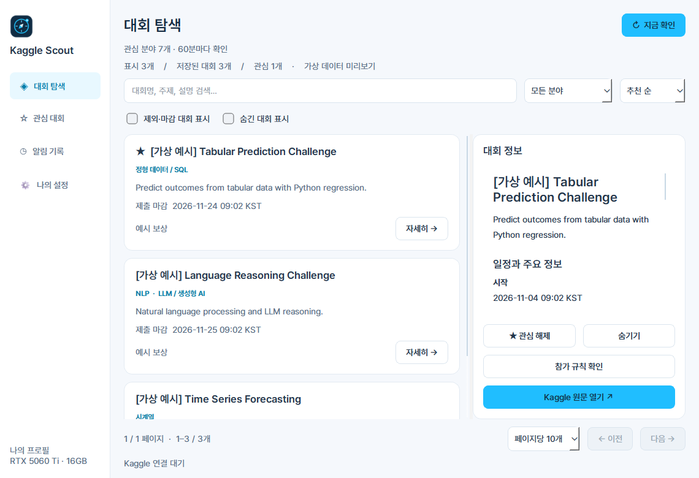
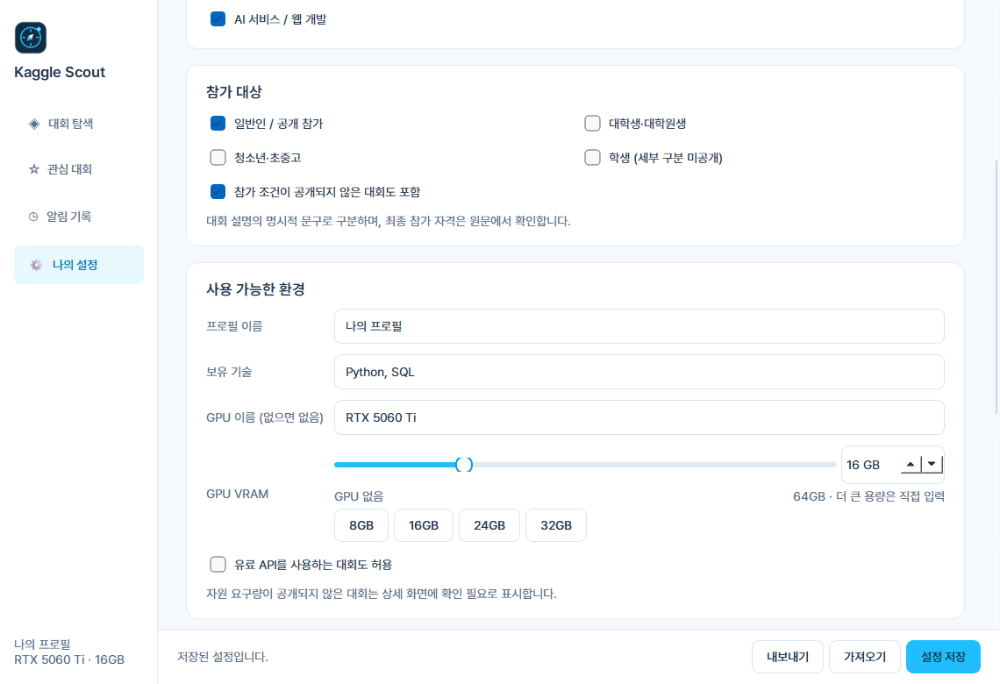
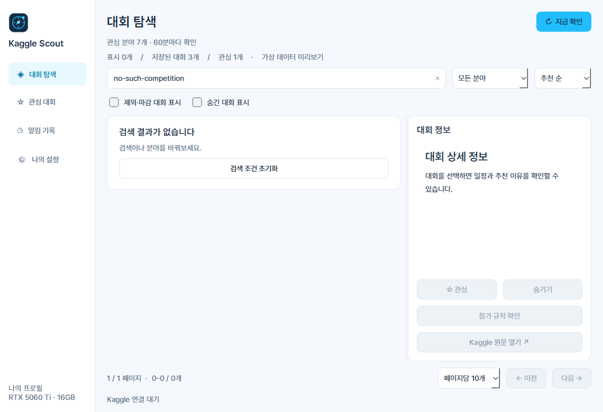

# 0.3.0 UX 검토

2026-11-06. 대상: 대회 탐색 → 환경 설정 → 검색 결과 없음 복구. 실제 Qt 앱의 소스 화면을 별도 임시 DB와 가상 대회로 실행해 캡처했습니다. 사용자 토큰이나 실제 참가 기록은 사용하지 않았습니다.

## 1. 대회 탐색 — 양호

목록과 상세를 함께 볼 수 있고 페이지 이동으로 전체 목록을 탐색합니다. 선택한 대회가 없을 때 상세 동작이 눌리지 않도록 했습니다. 비활성 원문 버튼도 회색으로 구분합니다. 실제 참가 자격과 GPU 적합성은 확인되지 않은 경우 확정하지 않습니다.

## 2. 환경 설정 — 개선 완료

이전에는 숫자 증감 화살표만 있었고 저장 버튼을 찾기 위해 아래로 이동해야 했습니다. VRAM·주기·추천 범위에 슬라이더와 정확한 숫자 입력을 함께 제공하고, 빠른 선택과 고정 저장 영역을 추가했습니다. 키보드 방향키와 큰 VRAM 값을 유지하는 동작을 테스트했습니다.

저장 전 후보 수는 현재 수집된 목록으로 계산하며 네트워크 요청은 하지 않습니다. 저장은 현재 화면에서 완료하고, 최초 연결 후 첫 수집만 자동 시작합니다. 후보 수는 참가 가능성이나 성능 예측이 아닙니다.

## 3. 검색 결과 없음 — 복구 경로 개선

이전에는 이미 목록이 있어도 계정 연결을 안내했습니다. 검색 실패·조건 불일치·빈 관심 목록·연결 전 상태를 구분하고, 검색 초기화나 조건 조정 등 맞는 행동을 제공합니다. 미선택 버튼은 비활성 표시합니다.

## 한계와 다음 개선

스크린샷은 기본 배율의 로컬 화면입니다. Narrator, 고배율 DPI, 실제 계정별 대회 접근 권한, Windows 알림 전달은 이 화면 검토만으로 검증하지 않았습니다. 전체 접근성 준수 판정은 아닙니다. 추가 우선순위는 [ROADMAP.md](../ROADMAP.md)를 참조하세요.
