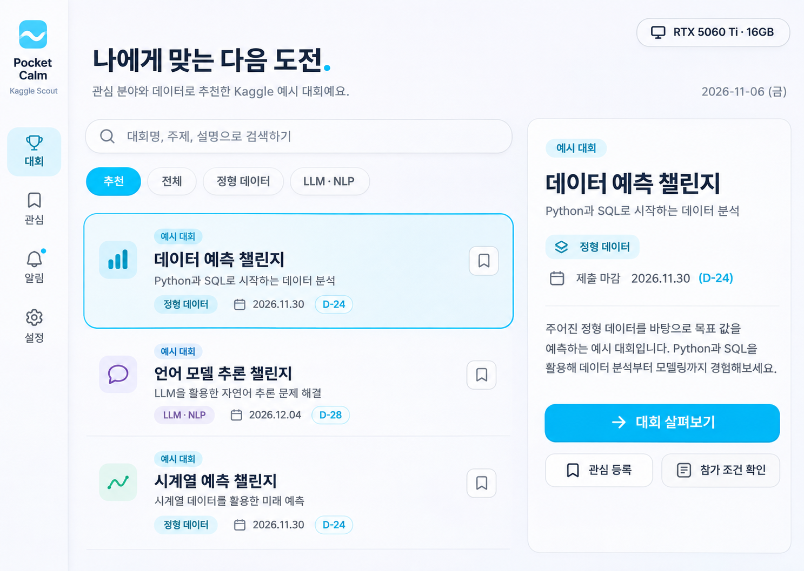
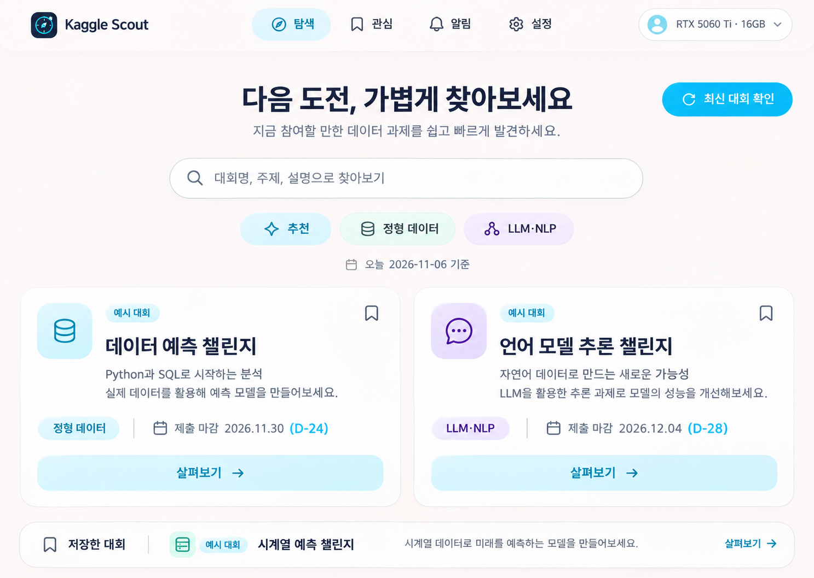
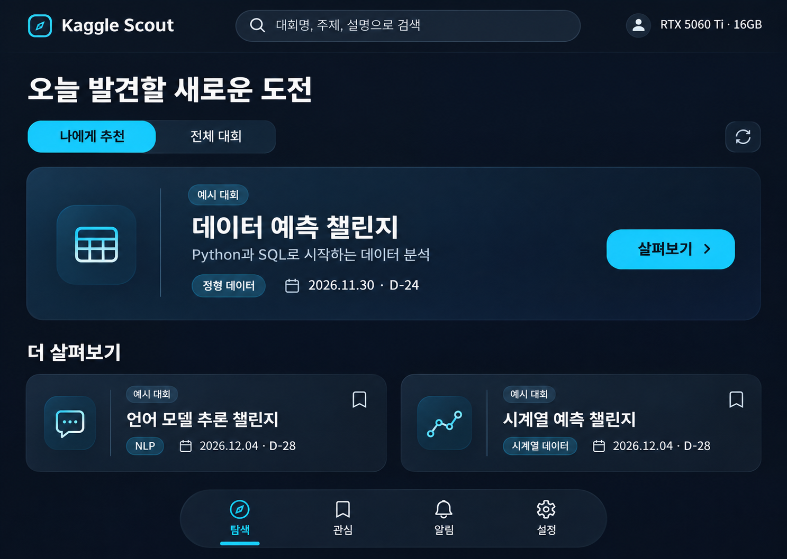

# 모바일 앱 감성의 UI 탐색

2026-11-06. 사용자는 PC 툴보다 모바일 앱의 예쁜 구성·형태를 참고하기를 요청했습니다. PC에서 사용한다는 점, Kaggle 하늘색, 한국어, 기존 대회·관심·알림·설정 기능을 유지하는 방향입니다.

내장 ImageGen으로 서로 다른 시안 3개를 생성했습니다. 채팅에 표시된 순서와 파일 번호가 일치합니다. 현재는 사용자 선택 대기이며 실제 UI 코드·설치 앱은 변경하지 않았습니다. 시안은 예시 대회를 사용한 이미지이며 동작하는 앱이 아닙니다. 선택 후 실제 컴포넌트·아이콘·크기·텍스트를 검증해 구현합니다. 최종 제품 이름은 Kaggle Scout입니다.

1. 
2. 
3. 

시각적 방향: 모바일 앱에서 쓰는 읽기 쉬운 타이포그래피, 부드러운 형태, 칩·짧은 탐색, 일관된 선형 아이콘. 숫자로 선택한 시안을 기준으로 후속 디자인을 진행합니다. 다른 앱의 상표나 고유 자산을 복제하는 작업은 아닙니다.

참고한 공개 자료: [Google Material Expressive](https://design.google/library/expressive-material-design-google-research), [Material Lists](https://m3.material.io/components/lists/overview), [Lucide](https://lucide.dev/license). PC 디자인 참고를 먼저 검토했으나 사용자 요청에 따라 모바일 앱 중심으로 방향을 바꿨습니다.
