# 버전별 프로그램 화면

릴리스의 예시 데이터 화면 원본을 보관합니다. 실제 개인 계정 화면은 포함하지 않습니다. 기존 버전 이미지는 덮어쓰지 않습니다. 출처는 sources.json에 기록합니다.

새 릴리스에는 실제 앱에서 만든 예시 화면을 `docs`에 저장하고 다음 명령으로 추가합니다. 동일 버전에서 화면을 더 남길 때는 다른 파일명을 사용합니다. 서로 다른 내용의 기존 파일을 덮어쓰려 하면 중단합니다.

```powershell
python archive_screenshots.py --version 0.5.0 --fixture-only docs/dashboard-final-v050.png
```

## v0.1.1

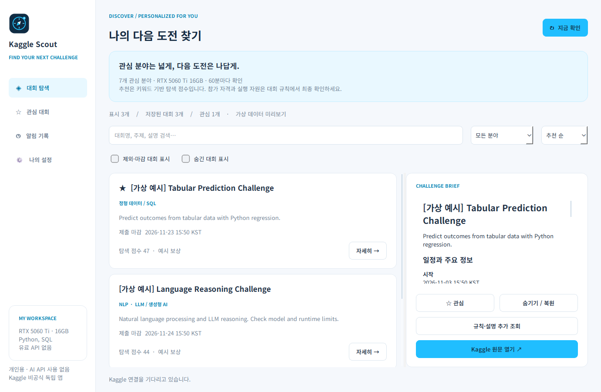

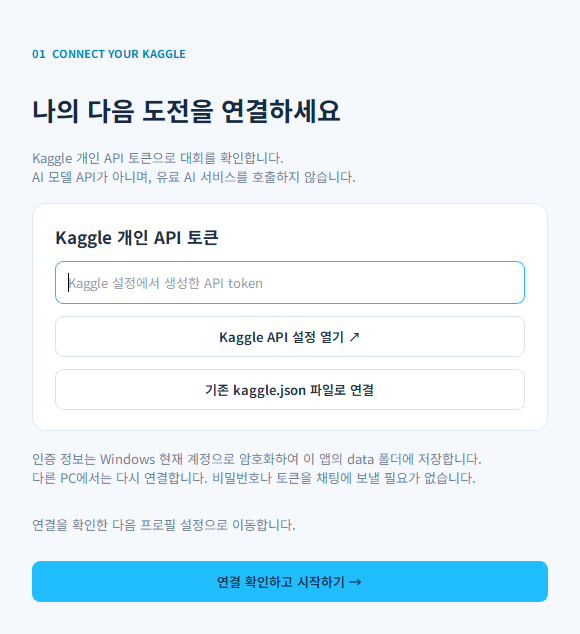

## v0.2.0

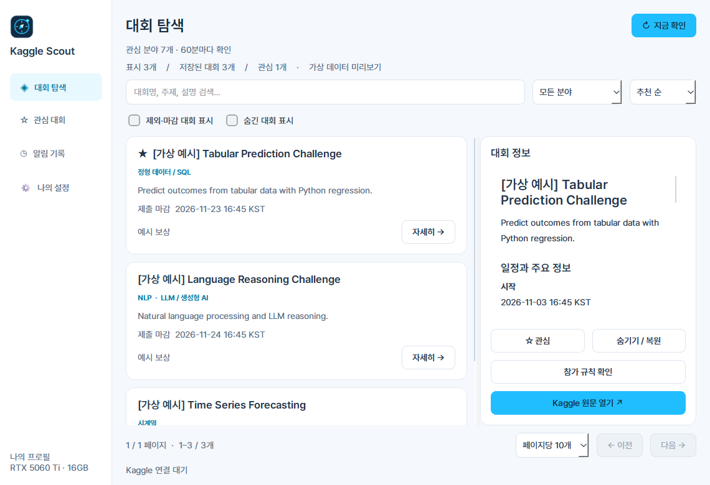

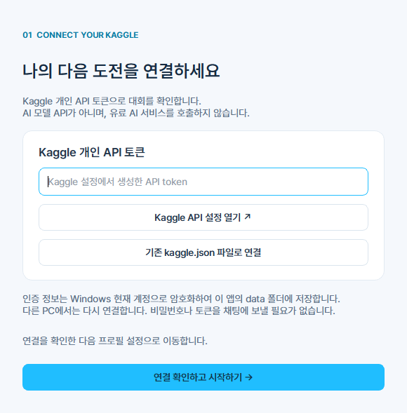

## v0.3.0


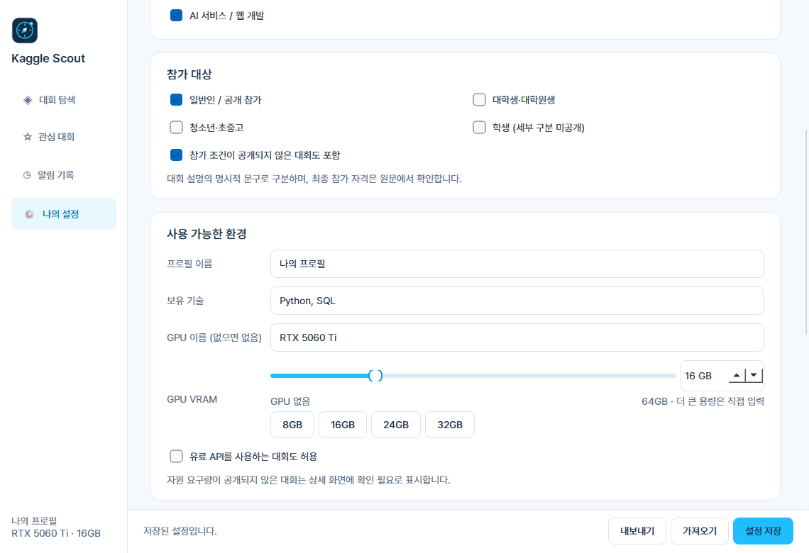

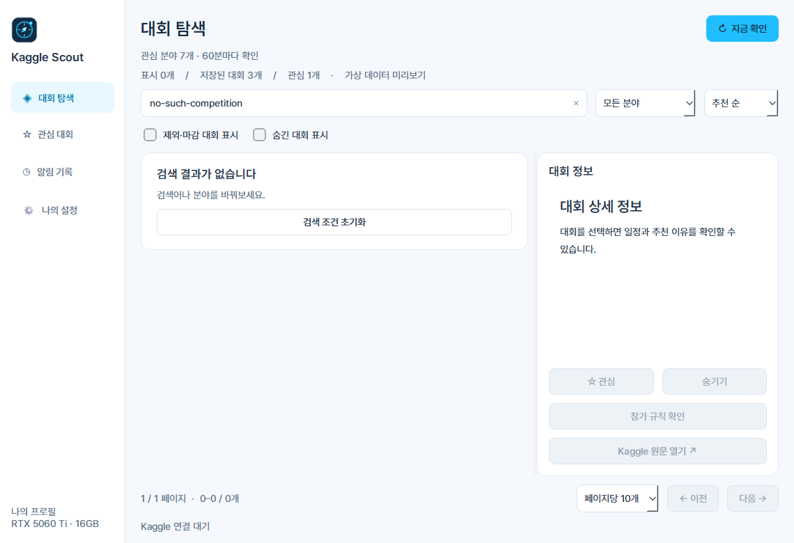

## v0.4.0

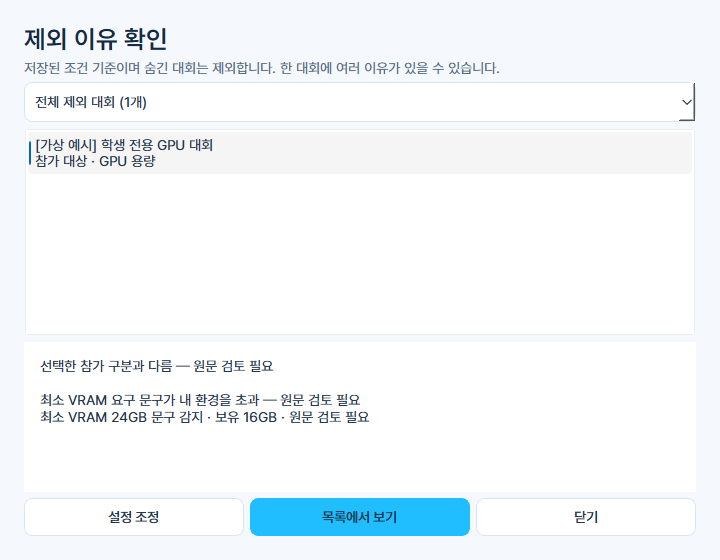

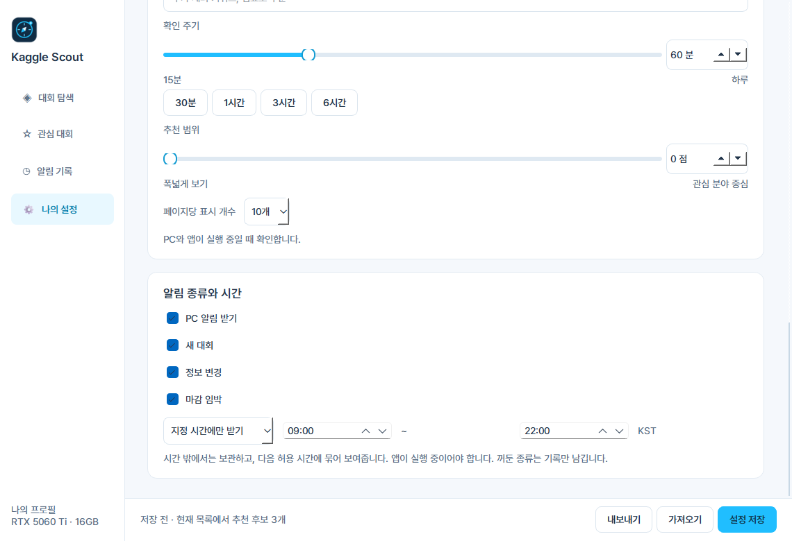

## v0.5.0

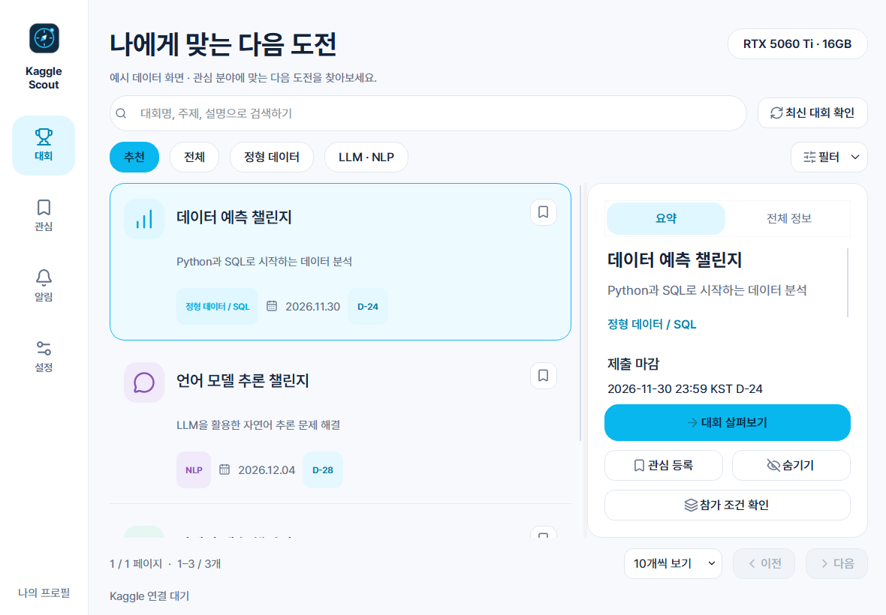

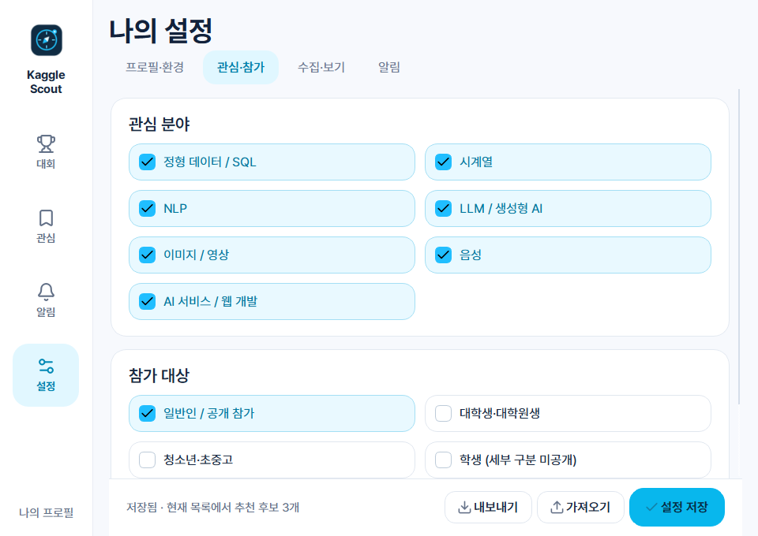

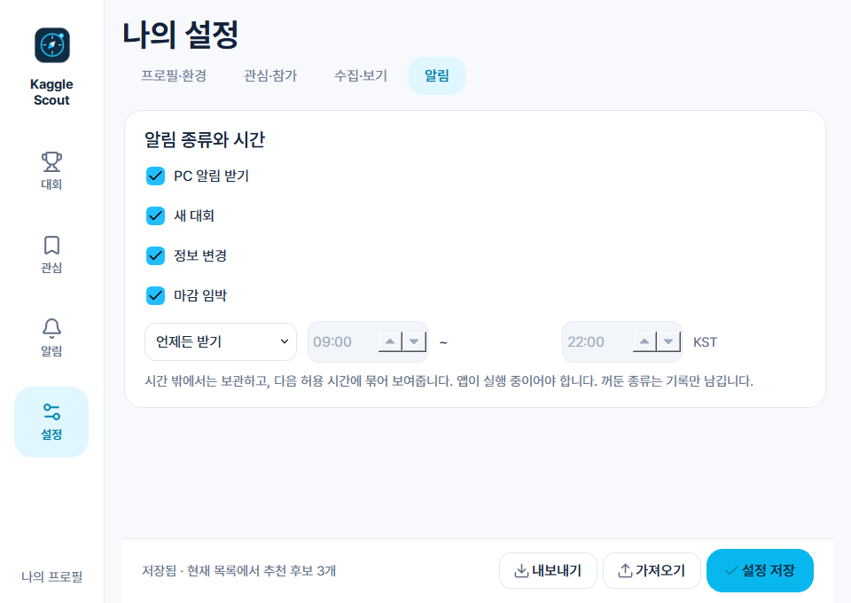

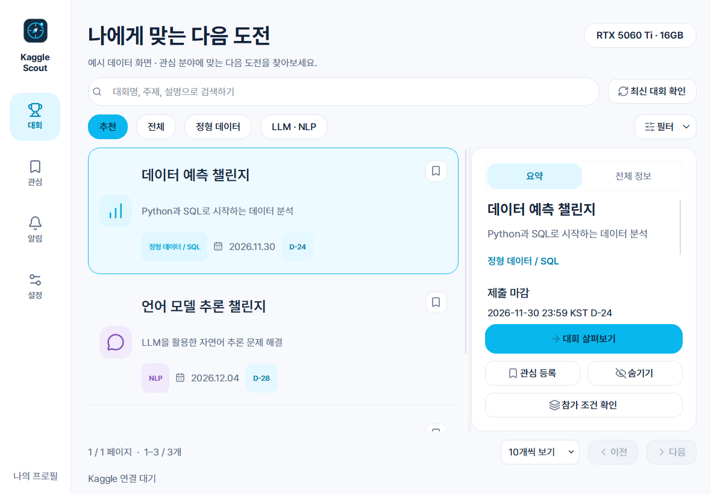
